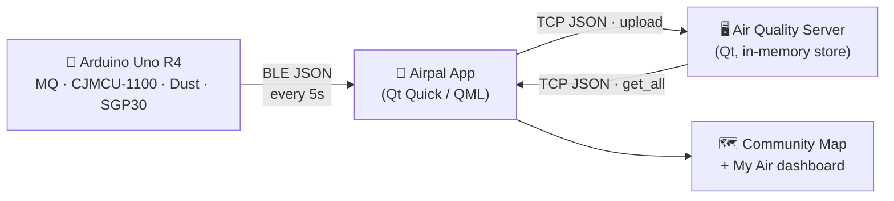

# 🌫️ Airpal — Community Air Quality Monitoring

> A HackDavis project: an Arduino-powered air quality sensor, a Qt mobile app, and a lightweight server that together turn real-world sensor readings into a shareable community air-quality map.


-41CD52)


---

## Overview

Airpal is a full-stack environmental monitoring system built in 24 hours. A small
Arduino device measures the air around you — gas, dust/PM2.5, eCO₂ and TVOC — and
broadcasts a live reading over Bluetooth Low Energy. The **Airpal** phone app
(built with Qt Quick) reads that data, shows it on a friendly dashboard, and
uploads it (with your location) to a server. Everyone's readings are then pulled
back into a shared **community map**, so you can see whether the air around you is
healthy or not.

It combines **hardware, sensors, networking, and UI design** into one practical
tool for environmental awareness.

## How it works



1. The **Arduino** samples its sensors, computes an AQI, and advertises a BLE
   characteristic with `{ AQI, Carbon_LEVEL, PM25, TVOC_level }`.
2. The **app** connects over BLE, displays the live readings, and uploads them —
   tagged with the phone's GPS location — to the server over raw TCP + JSON.
3. The **server** keeps the latest reading per device in memory and serves the
   full list back to the app for the community map.

## Features

- 📶 **BLE sensor link** — connects directly to the Arduino air-quality node
- 📊 **Live dashboard** — AQI gauge plus PM2.5, carbon (eCO₂) and TVOC metrics
- 🗺️ **Community map** — see readings uploaded by other devices, by location
- ☁️ **Lightweight server** — raw TCP + JSON, no database required
- 📱 **Android-ready** — packaged as the "Airpal" app with the needed permissions

## Repository structure

```text
HACKDAVIS_AIRPAL/
├── arduino/
│   └── AirQualityMonitor.ino     # BLE sensor firmware (Arduino Uno R4 WiFi)
├── backend/                      # App C++ backend
│   ├── AirQualityController.*    #   orchestrates readings, exposes them to QML
│   ├── BluetoothManager.*        #   scans/connects to the sensor over BLE
│   ├── ServerClient.*            #   TCP/JSON client to the server
│   ├── DeviceIdProvider.*
│   ├── AirQualityReading.h
│   └── AppConstants.h
├── qml/                          # Qt Quick UI
│   ├── Main.qml  SplashScreen.qml  HomePage.qml  MyAir.qml
│   ├── CommunityMap.qml  CommunityPage.qml  TestingPage.qml
│   └── components/               #   AQIGauge, MetricCard, MetricInfoDrawer, …
├── resources/images/             # App icons & artwork
├── android/                      # Android packaging (icon, app name)
├── main.cpp                      # Server entry point
├── qAQMS.* / qAQMSConst.h        # TCP/JSON air-quality server
├── CMakeLists.txt                # Build for the Qt Quick app
├── AirQualMonitorServer.pro      # qmake build for the server
├── SERVER_API.md                 # Server protocol reference
└── README.md
```

## Tech stack

| Layer     | Technology                                                                 |
|-----------|----------------------------------------------------------------------------|
| Firmware  | Arduino (C++), Bluetooth Low Energy, ArduinoJson                           |
| App       | Qt 6 · Qt Quick / QML · QuickControls2 · C++17 · Bluetooth / Network / Location |
| Server    | Qt 6 Core & Network · raw TCP · JSON                                        |
| Tooling   | CMake (app) · qmake (server) · Arduino IDE (firmware)                       |

## Hardware

The sensor node runs on an **Arduino Uno R4 WiFi** (using BLE, not WiFi) and
broadcasts as the BLE peripheral **`AirQualityMonitor`**.

| Sensor            | Pin      | Measures                          |
|-------------------|----------|-----------------------------------|
| MQ gas sensor     | `A0`     | General gas level                 |
| CJMCU-1100        | `A1`     | Gas / air quality                 |
| GP2Y1010 dust     | `A2` (LED `D2`) | Particulates → PM2.5 & AQI |
| SGP30 (I²C)       | `SDA/SCL`| eCO₂ (carbon) & TVOC              |
| Grove RGB LCD     | `I²C`    | On-device readout                 |
| Power switch      | `D4`     | Turns sampling on/off             |

**Required libraries:** ArduinoBLE, ArduinoJson, Adafruit SGP30, Adafruit BusIO,
Grove RGB LCD (`rgb_lcd`). Full wiring notes are in the header of
[`arduino/AirQualityMonitor.ino`](arduino/AirQualityMonitor.ino).

## Build & run

### 📱 App (Qt Quick)

Requires **Qt 6** with the `Core`, `Quick`, `QuickControls2`, `Network`,
`Positioning`, `Location` and `Bluetooth` modules.

```bash
cmake -S . -B build
cmake --build build
```

Or open `CMakeLists.txt` in **Qt Creator**. To deploy to a phone, build the
`appAirDavisApp` target with an Android kit.

### 🖥️ Server

Requires **Qt 6** (`Core`, `Network`).

```bash
qmake AirQualMonitorServer.pro
make
./AirQualMonitorServer
```

The server listens for raw TCP connections and speaks JSON — see
**[SERVER_API.md](SERVER_API.md)** for the full `upload` / `get_all` / `clear_all`
protocol.

### 🔌 Firmware

1. Open [`arduino/AirQualityMonitor.ino`](arduino/AirQualityMonitor.ino) in the Arduino IDE.
2. Install the required libraries listed above.
3. Select **Arduino Uno R4 WiFi**, wire the sensors per the header comment, and upload.

## Acknowledgments

Built in 24 hours at **HackDavis**. Shared as-is — feel free to fork and extend.
